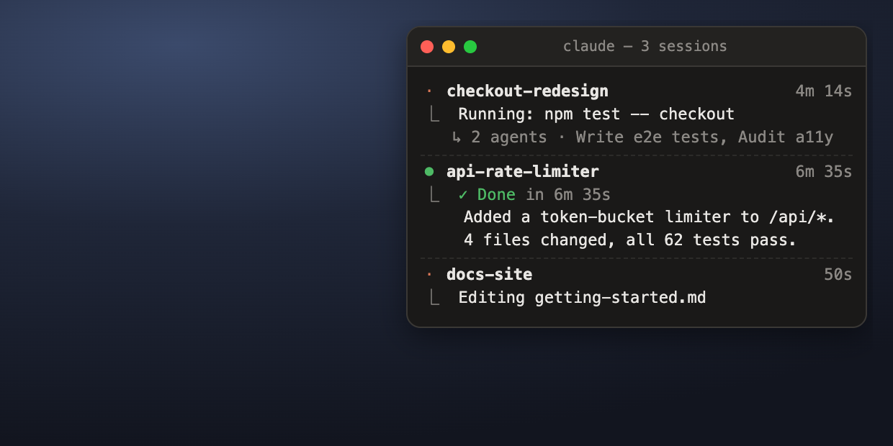
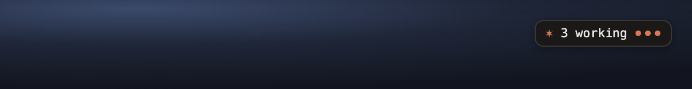
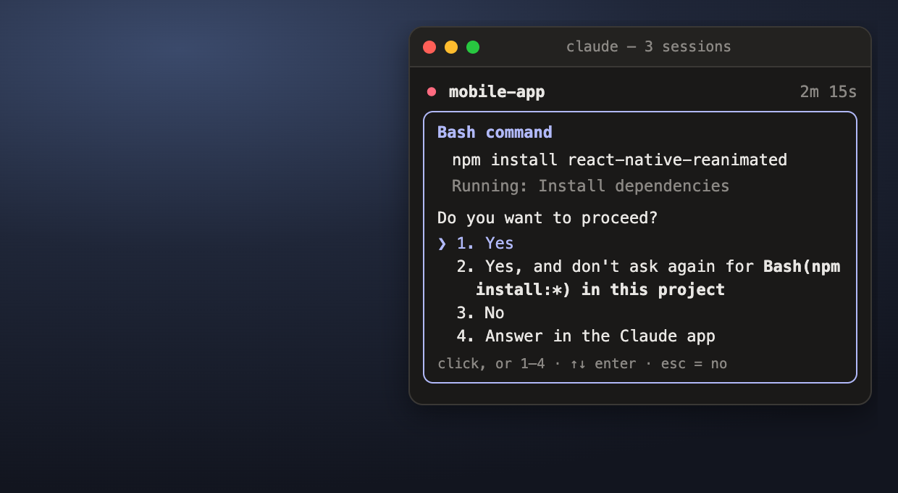
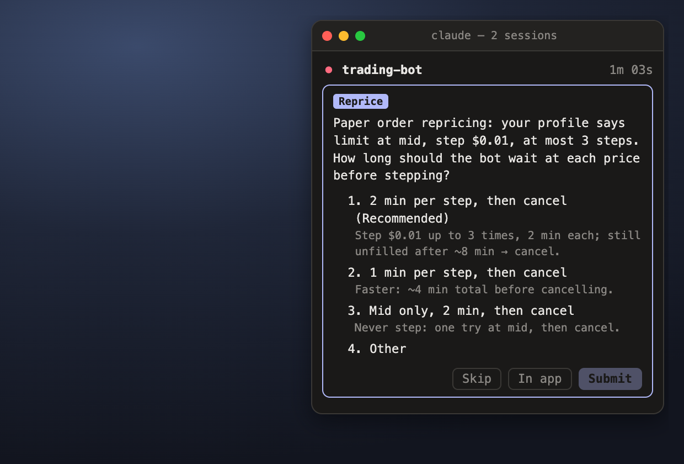

# Claude Pet

**See your Claude Code agents working, right on your screen.**

Claude Pet is for people who run Claude Code agents and want to watch them work without keeping a Claude window open. A small terminal-style widget sits in the corner of your Mac, above every app. It shows what each agent is doing right now, and it pops open when one of them needs you: to approve a command, answer a question, or look at finished work.



## Why

When you run several Claude Code sessions at once, you end up switching windows to check on each one, and an agent waiting for your approval just sits there until you notice. Claude Pet keeps them all in view:

- **See every agent at a glance:** what it's doing, how long it has been working, and how many subagents it's running.
- **Approve without switching windows:** Claude Code's own permission prompt appears right in the widget.
- **Answer an agent's questions** in the widget too, with its real options.
- **Know the moment something finishes:** a green ✓ with Claude's summary, a sound, and a notification.
- **Spot stuck agents:** anything quiet for 10 minutes turns amber.

## What it looks like

**Folded:** one line in the corner while everything runs on its own.



**An agent needs approval:** it opens by itself with the same choices the CLI gives you.



**An agent asks you a question:** pick an option, or choose Other and type your own answer.



## Using it

| Do this | To |
|---|---|
| Click the folded line | Open the list of all agents |
| Click an agent | Jump to that session in the Claude desktop app |
| Click a prompt option, or press `1`–`4` / `↑↓` + `Return` | Answer a permission prompt (`Esc` = No) |
| Click anywhere else | Fold it back up |
| Drag it | Move it anywhere on screen |
| Right-click | Show all sessions, mute sounds and notifications, quit |

It opens by itself only for approvals, questions, finished work (for 3 minutes) and stuck agents. The rest of the time it stays one line. Sessions disappear after 2 hours with no activity.

## Install

You need macOS, [Claude Code](https://claude.com/claude-code) (the CLI or the Claude desktop app), Python 3, and Xcode Command Line Tools (`xcode-select --install`).

```bash
git clone https://github.com/rkalkan-a/claude-pet.git
cd claude-pet
./build.sh                       # builds the app into ~/.claude/pet and copies the hook there
bash ~/.claude/pet/install.sh    # adds the hooks to ~/.claude/settings.json and starts the pet at login
```

Sessions you start after installing will show up in the bottom-right corner. macOS will ask once whether Claude Pet may send notifications.

**Uninstall:** restore `~/.claude/settings.json.bak-pet` (or delete the hooks that mention `pet/hook.py`), delete `~/Library/LaunchAgents/com.claudepet.plist`, then delete `~/.claude/pet`.

## How it works

- **`hook.py`** is a [Claude Code hook](https://docs.claude.com/en/docs/claude-code/hooks). On each event (prompt sent, tool used, subagent started or finished, finished, needs input), it writes that session's status to `~/.claude/pet/sessions/`.
- **Permission requests and questions:** the hook waits for your answer from the pet. If you don't answer within 9 minutes, Claude Code shows its normal prompt instead. **The pet never approves anything on its own.**
- **`ClaudePet.swift`** is a small native macOS app: a floating, always-on-top panel showing `pet.html`, which reads those status files.
- **Everything stays on your Mac.** Nothing is sent anywhere.

`docs/demo.html` renders the widget with made-up sessions; it's how the screenshots above were made. After changing the code, run `./build.sh` again.

## Notes

- **Jump to session** works with the Claude desktop app. For sessions running in a terminal, clicking just brings the Claude app forward.
- **"Yes, and don't ask again"** saves Claude's own suggested permission rule, exactly like choosing it in the CLI.
- **Stuck alerts:** a single command that runs silently for over 10 minutes (a long build, for example) also turns a session amber.
